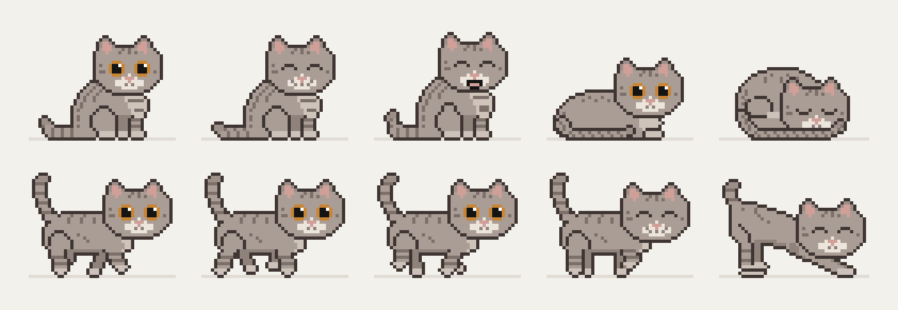

# Котик Богдан

Пиксельный кот, который живёт на рабочем столе Windows. Гуляет по панели задач и по окнам, запрыгивает
на значки и спит на папках, играет с курсором и мурчит, когда его гладят. Похож на Desktop Goose, только
добрый: никогда не двигает курсор, не трогает окна и не забирает фокус.



## Что он умеет

- гуляет по панели задач и верхним краям окон; если перетащить окно, на котором он сидит, — едет вместе с ним
- прыгает по значкам рабочего стола и дремлет на папках, перед сном «месит» место лапками
- иногда точит когти о значок — на нём остаются царапины (их можно убрать из меню)
- играет с курсором: подкрадывается, виляет попой, прыгает, бьёт лапкой
- мурчит и пускает сердечки, когда его гладят; медленно моргает, если курсор долго рядом
- его можно взять мышкой, перенести и бросить — приземлится на лапки
- живёт поверх всех окон или только на рабочем столе, под окнами (подходит и для живых обоев Wallpaper Engine)
- прячется, пока открыта игра или видео на весь экран
- 10 окрасов, можно раскрасить своего кота в настройках

## Управление

| действие | как |
|---|---|
| погладить | поводить курсором туда-сюда по коту или щёлкнуть |
| «Мяу!» | двойной щелчок по коту |
| взять на ручки | зажать левую кнопку на коте и перенести |
| позвать | двойной щелчок по значку в трее |
| меню | правая кнопка по коту или по значку в трее |

Настройки и царапины хранятся в `%APPDATA%\DesktopCat`.

## Запуск

Нужна Windows 10 или 11 — больше ничего: программа работает на .NET Framework 4.8, который уже встроен в систему.
Файл без цифровой подписи, поэтому при первом запуске SmartScreen может предупредить:
«Подробнее» → «Выполнить в любом случае».

## Сборка

```
build.cmd
```

Собирает `bin\DesktopCat.exe` компилятором C#, который входит в состав Windows (`csc.exe` из .NET Framework 4.8),
поэтому код написан на C# 5. Visual Studio и .NET SDK не нужны.

## Рисунок кота

Спрайты генерируются из текстовых пиксельных сеток (Python 3 и Pillow):

```
python tools/sprites/bogdan.py
python tools/sprites/gen_cs.py
```

Первый скрипт собирает кадры всех анимаций, второй записывает их в `src/SpriteArt.cs`.

## Устройство

| файлы | что внутри |
|---|---|
| `src/Core.cs` | общие типы: платформы, снимок мира, анимации, палитры, настройки |
| `src/World*.cs`, `src/DesktopIcons.cs`, `src/DesktopZOrder.cs` | чтение рабочего стола: мониторы, значки, окна, перекрытия, полноэкранные приложения, z-порядок |
| `src/CatBrain.cs`, `src/Brain*.cs` | характер, физика прыжков, поиск пути |
| `src/Sprite*.cs`, `src/PalettePresets.cs` | спрайты и окрасы |
| `src/App*.cs`, `src/CatWindow*.cs`, `src/Effects.cs`, `src/Tray.cs`, `src/Settings*.cs` | приложение, прозрачное окно кота, эффекты, трей, настройки |
